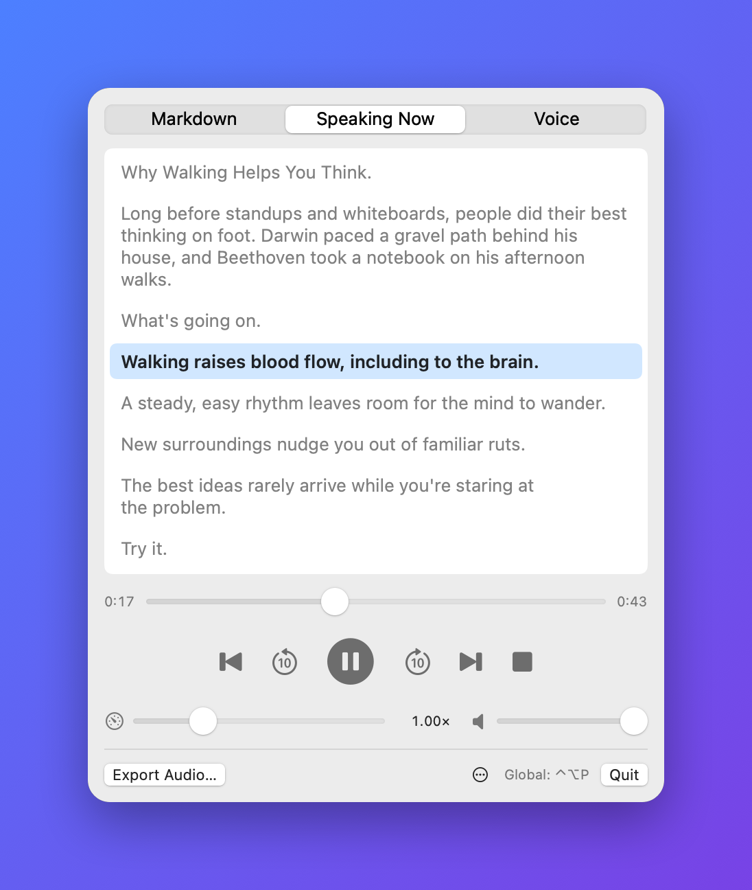

# MDReader

**Paste Markdown, hear it read aloud — right from your menu bar.**

MDReader turns notes, READMEs, docs and articles written in Markdown into natural-sounding speech.
It reads the words, not the formatting: no "hash hash", no "asterisk", no URLs spelled out.
Everything happens on your Mac, and your text never leaves it.

  

## Features

- **Natural voices.** 54 voices in 9 languages, powered by [Kokoro](https://huggingface.co/hexgrad/Kokoro-82M).
- **Reads Markdown properly.** Headings, lists, links, tables and quotes are spoken the way a person would read them. Code blocks are skipped.
- **Follow along.** The *Speaking Now* view highlights the paragraph being read; click any paragraph to jump to it.
- **Real playback controls.** Skip ±10 seconds, jump between paragraphs, scrub, and change speed from 0.5× to 2.5× without chipmunk voices.
- **Works with your keyboard and headphones.** Media keys, AirPods and Control Center all control playback, and ⌃⌥P plays or pauses from any app.
- **Save it for later.** Export the audio as an `.m4a` file to listen on your phone or in the car.
- **Stays out of the way.** Lives in the menu bar, with an optional full window for long documents.
- **Stays up to date.** Checks for new versions on its own and installs them when you say so.

## Requirements

- A Mac with Apple silicon (M1 or later)
- macOS 14 Sonoma or later
- An internet connection the first time you press Play, to download the voice model (about 350 MB, once)

## Install

1. Download the latest `MDReader.zip` from the [Releases](../../releases) page.
2. Unzip it and drag **MDReader** into your Applications folder.
3. Open it. A speaker icon appears in the menu bar — MDReader has no Dock icon.

## Getting started

1. Copy some Markdown, click the speaker icon in the menu bar and choose **Paste from Clipboard**.
2. Press **Play**. The first time, MDReader downloads its voice model; after that it starts in seconds.
3. Switch to **Speaking Now** to follow along, or keep working — playback continues while the panel is closed.

For long documents, choose **Open in Window** to get a resizable window with the same controls.

## Controls

| Key | Action |
|---|---|
| Space | Play / pause |
| ← / → | Back / forward 10 seconds |
| ⇧← / ⇧→ | Previous / next paragraph |
| ⌘↑ / ⌘↓ | Faster / slower |
| ⌃⌥P | Play / pause from any app |

The keys above work while the MDReader panel or window is in front and you're not typing in the editor.
The play/pause, next and previous media keys work everywhere.

## Voices

Open the **Voice** tab and pick a voice from the list — they're grouped by language. Press **Test** to hear a short sample before you commit.

The default voice is *Heart* (American English). Voices in other languages download a little extra pronunciation data the first time you use them.

## What gets read

MDReader reads your document the way you'd read it aloud to someone:

| In your Markdown | What you hear |
|---|---|
| `# A heading` | "A heading", followed by a short pause |
| `**bold**`, `_italic_`, `` `code` `` | Just the words |
| `[the docs](https://…)` | "the docs" |
| `` | "a diagram" (images without a description are skipped) |
| A bare link like `https://example.com` | Skipped |
| A list | Each item as its own sentence |
| A table | Each row, with cells separated by short pauses |
| A code block | Skipped — or "Code block omitted", if you choose that in the Voice tab |

## Privacy

Your text is turned into speech on your Mac and never sent anywhere. MDReader only goes online for
two things: downloading the voice model and pronunciation data from [Hugging Face](https://huggingface.co)
the first time they're needed, and checking GitHub for new versions. It has no analytics and no account.

## Troubleshooting

**The first Play takes a while.** That's the one-time model download. You'll see its progress at the bottom of the panel.

**It says it couldn't download the voice model.** Check your internet connection and press Play again.

**Pressing Play again on the same text is instant.** That's on purpose: generated audio is saved, so unchanged text isn't generated twice. Changing the text or the voice generates it again.

**How do I update?** MDReader checks for updates automatically. To check now, click **⋯** at the
bottom of the panel and choose **Check for Updates…**.

**I want the disk space back.** Generated audio is kept in MDReader's caches, which macOS can clear
when space runs low. The voice model takes up to about 750 MB. To remove everything, quit MDReader
and delete `~/Library/Containers/com.push1kb.MDReader`; it downloads again the next time you press Play.

## Known limitations

- Playback starts once the whole document has been generated; long documents take a little longer before the first word.
- Dragging the speed slider can cause a brief gap in the audio.
- English voices sound the most natural; other languages vary.

## Building from source

Open `MDReader.xcodeproj` in Xcode 16 or later and press Run. If the build reports a missing Metal
Toolchain, install it once with `xcodebuild -downloadComponent MetalToolchain`.

See [CONTRIBUTING.md](CONTRIBUTING.md) for building from the terminal, tests, how the code is
organized, and what to know before changing playback.

## Credits

MDReader is built on [Kokoro-82M](https://huggingface.co/hexgrad/Kokoro-82M) by hexgrad, [mlx-audio-swift](https://github.com/Blaizzy/mlx-audio-swift) by Blaizzy and contributors, and Apple's [MLX](https://github.com/ml-explore/mlx-swift).

## License

MDReader is released under the [MIT License](LICENSE).
